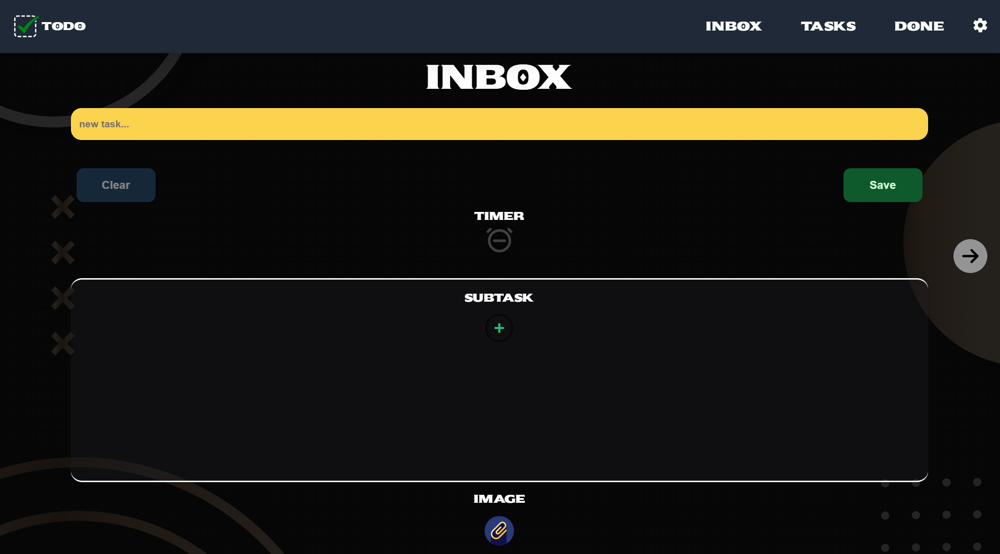
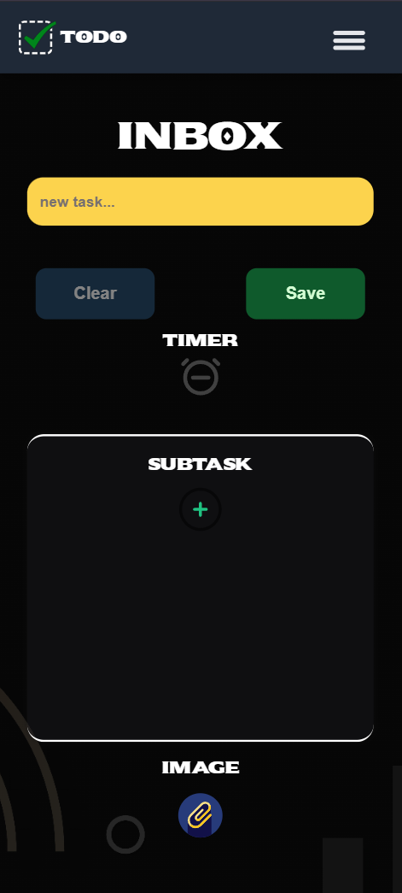
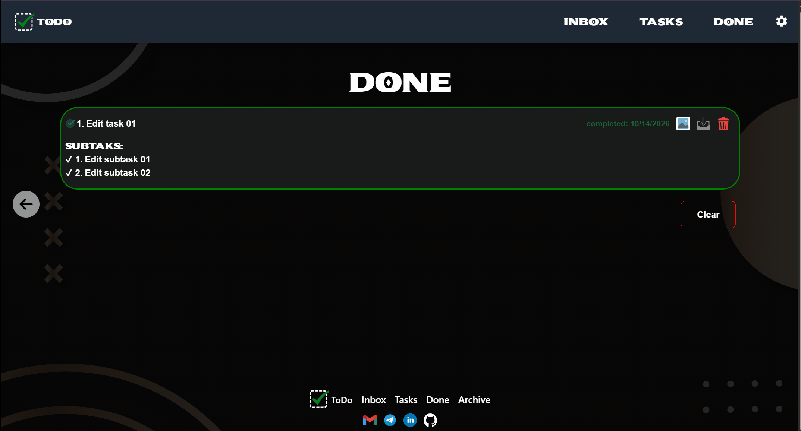
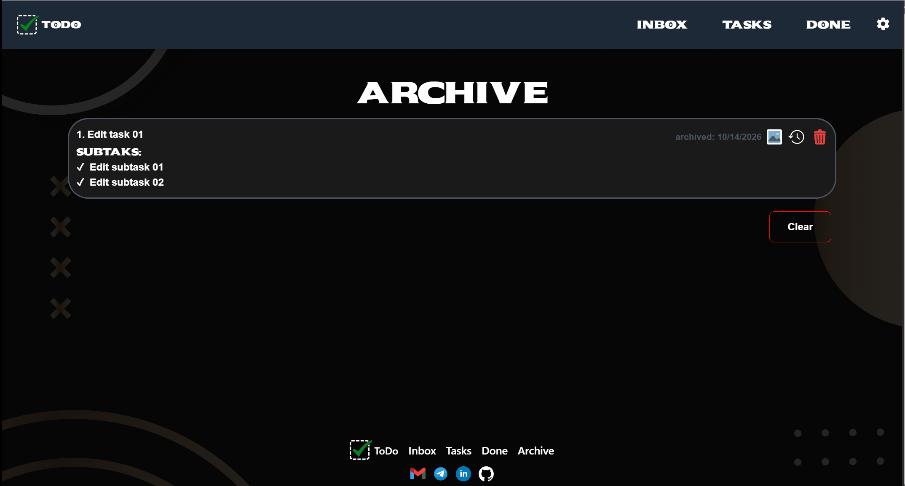
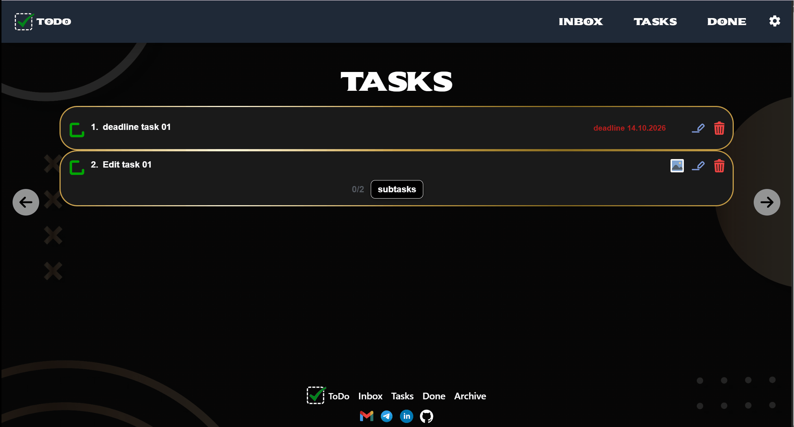
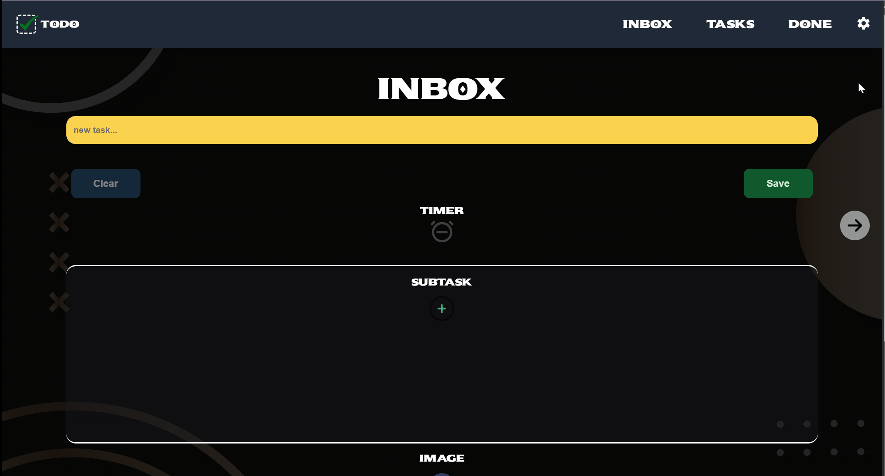

# TodoApp

A task manager for people who plan their day and set goals for themselves: tasks with deadlines, images and subtasks, plus archive and restore.

[Live demo](https://todo-app-gamma-nine-52.vercel.app/)

| Desktop | Mobile |
|:---:|:---:|
|  |  |

## About

This app is built for everyday tasks. Each task can have a deadline, an image for visual context, and subtasks, which helps users break a bigger goal into clear, structured steps. It supports three languages and a light/dark theme, and gives instant feedback through popups and smooth animations.

## Features

- Create tasks with a deadline, an image and subtasks
- Edit tasks and subtasks
- Complete tasks, archive them and restore them to their original position
- Deadline and completion date tracking
- Overdue tasks are automatically moved to the "failed" list
- Task limits (20 active, 15 completed, 15 archived) with a warning popup
- Multilanguage: English, Polish, Ukrainian
- Light / dark theme
- Popups for different interactions (created, completed, restored, limit reached)

## Demo

### Creating task with timer, subtasks and image


### Editing task and subtask


### failed task panel


### Completing task and subtask


### deleting task and subtask


### archiving task


### restoring task


### Theme switching


### Language switching


## Tech Stack

| Layer | Technologies |
|---|---|
| Frontend | React 19, TypeScript, Vite |
| State management | Redux Toolkit, Redux-Saga, typed-redux-saga |
| Backend | Supabase (Postgres, Auth, Storage) |
| Styling | Tailwind CSS 4 |
| Forms | React Final Form, Final Form Arrays |
| UI | Headless UI, react-calendar, Embla Carousel |
| Testing | Vitest, React Testing Library |
| Deployment | Vercel |

## Project Structure

```
├── docs/          # screenshots and GIFs for the README
├── public/        # static assets
├── supabase/      # Supabase config and migrations
└── src/
    ├── api/         # Supabase RPC calls
    ├── assets/      # images and fonts
    ├── components/  # reusable UI components
    ├── context/     # language and theme context, translations
    ├── helpers/     # helper functions (auth, image removal)
    ├── hooks/       # custom React hooks
    ├── icons/       # JSX icons
    ├── pages/       # Inbox, Tasks, Done pages
    ├── store/       # Redux slices and sagas
    ├── types/       # TypeScript types
    └── utils/       # utility functions
```

## Architecture

- **State management.** Two Redux Toolkit slices (`tasks` and `subtasks`) hold the state, and all side effects live in Redux-Saga with typed `yield*`. Every operation follows the same `request → success / failure` pattern, so components only dispatch actions and read state.
- **Optimistic updates.** Creating, completing, deleting and editing tasks, toggling subtasks and restoring from the archive update the UI instantly while the Supabase request runs in the background. A backup of the previous state is kept, and if the request fails, the change is rolled back (for example, a restored task returns to its original position in the archive).
- **Supabase.** Postgres for tasks and subtasks (a task and its subtasks are created atomically through an RPC function), Storage for task images, Auth for sign-in. Data is isolated per user with Row Level Security.
- **Tested.** Pages and components are covered with Vitest and React Testing Library.

## Getting Started

### Prerequisites

- Node.js 20.19+ (or 22.12+)
- A free [Supabase](https://supabase.com) project

### Installation

```bash
git clone https://github.com/Kiril11v/todo-app.git
cd todo-app
npm install
```

### Supabase setup

1. Create a new project in the [Supabase dashboard](https://supabase.com/dashboard).
2. Open the **SQL Editor**, paste the contents of `supabase/schema.sql` and run it. This creates the `tasks` and `subtasks` tables, the `createTaskWithSubtasks` function and the Row Level Security policies.
3. Go to **Storage** and create a public bucket named `task-images`.

### Environment variables

Copy `.env.example` to `.env` and fill in the values from **Project Settings → API**:

```dotenv
VITE_SUPABASE_URL=your-supabase-project-url
VITE_SUPABASE_ANON_KEY=your-supabase-anon-key
```

### Run

```bash
npm run dev       # start the dev server (http://localhost:5173)
npm run build     # create a production build
npm run preview   # preview the production build locally
npm test          # run the tests
```

## Author

**Kiril** · [GitHub](https://github.com/Kiril11v) · [LinkedIn](www.linkedin.com/in/kyrylo-kud-3b4644334)